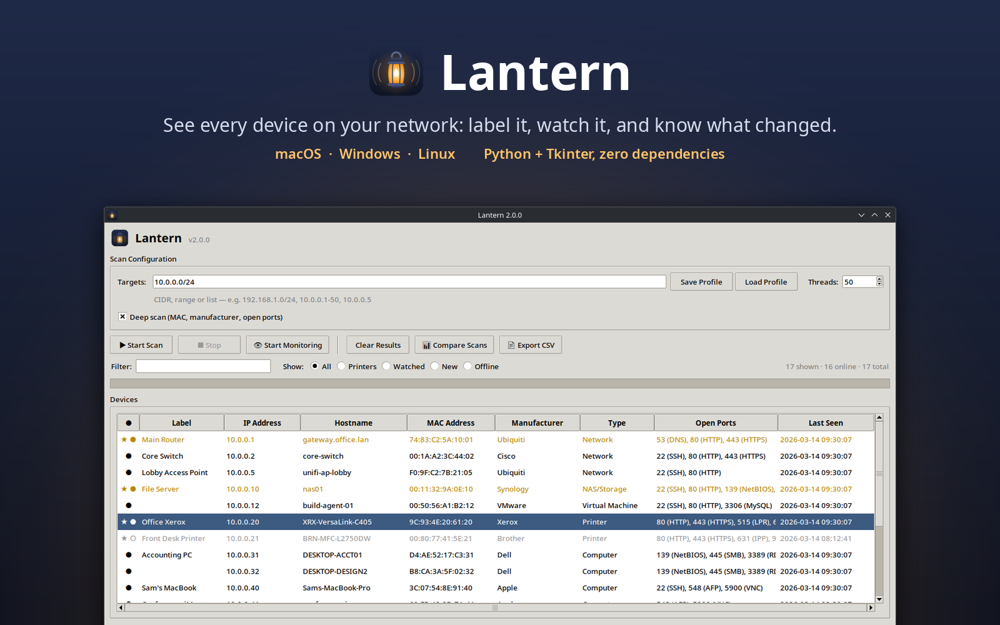

# 🏮 Lantern



**A network scanner for macOS, Windows and Linux with device labels, monitoring and scan history**

Lantern lights up your network: discover devices, identify manufacturers, watch the ones that matter, and see what changed between scans, all from a simple desktop GUI.


## ✨ Features

### Scanning
- 🔍 **Fast multi-threaded scanning** of a CIDR (`192.168.1.0/24`), a range (`10.0.0.1-50` or `10.0.0.1-10.0.1.20`) or a comma-separated mix
- 🌐 **Auto-detects your network** on startup
- 🏷️ **Manufacturer lookup** from the MAC address, including spotting phones and laptops using private (randomized) addresses
- 🔬 **Deep scan**: MAC address, manufacturer, reverse DNS and common open ports
- 🎯 **Device types**: Printer, Computer, Server, Network gear, NAS, Mobile, Smart Device, IoT, Virtual Machine
- 🖨️ **mDNS printer discovery** so printers show up first

### Device Management
- 📝 **Labels**: name your devices ("Office Xerox", "Living Room TV")
- 🗒️ **Notes**: keep documentation for each device
- 🏷️ **Type override** for when auto-detection guesses wrong
- ⭐ **Watch list** for the devices you care about

### Monitoring & History
- 👁️ **Live monitoring** of watched devices every 60 seconds, with an alert (and a beep) when one goes offline and a note when it comes back
- 📊 **Scan comparison**: pick any two saved scans to see new devices, missing devices and IP changes
- 📈 **Scan history**: the last 50 scans are saved automatically
- ○ **Offline marking**: devices from earlier scans that stop answering are greyed out

### Profiles, Filters & Export
- 💾 **Profiles**: save target, thread count and deep-scan setting for Home, Office, Guest…
- 🔎 **Search** across IP, MAC, hostname, manufacturer, type, label and notes
- 🧮 **Quick filters**: All, Printers, Watched, New, Offline
- ↕️ **Sort** by any column
- 📄 **CSV export** with labels, notes and watch status
- 📋 **Quick actions**: copy IP/MAC/hostname, open the device's web page, ping

## 🚀 Quick Start

### Run from source (Python 3.9+)

```bash
git clone https://github.com/mattgrilli/lantern.git
cd lantern
python3 lantern.py
```

Running from source needs only the Python standard library. Two optional extras:

- **mDNS on Windows and Linux**: `pip install zeroconf` (macOS already uses the built-in `dns-sd`)
- **Linux**: tkinter may be a separate package (`sudo dnf install python3-tkinter` or `sudo apt install python3-tk`)

Want to look around without scanning anything? `python3 lantern.py --demo` opens Lantern with a sample office network. Nothing is scanned or saved.

### Standalone app

Download the latest build from [Releases](https://github.com/mattgrilli/lantern/releases).

> **macOS Gatekeeper:** the first time, right-click the app and choose **Open**.

### Build it yourself

```bash
./build.sh          # macOS → dist/Lantern.app, Linux → dist/Lantern
./create_dmg.sh     # macOS only: package the app as a DMG
./install-linux.sh  # Linux only: add Lantern to your app menu
```

On Windows:

```bat
py -m pip install pyinstaller zeroconf
py -m PyInstaller --name Lantern --windowed --onefile --collect-submodules zeroconf --add-data "assets;assets" --icon assets\lantern.ico lantern.py
```

Built apps always include zeroconf, so mDNS printer discovery works without installing anything.

## 📖 Usage

### First scan
1. **Launch Lantern**. It fills in your network range automatically.
2. Click **▶ Start Scan** (or press ⌘R / Ctrl+R).
3. Devices appear as they're found. New devices since your last scan are highlighted in blue.

### Right-click a device to
- **Set Label…** / **Edit Notes…** / **Set Type**
- **Toggle Watch List**
- Copy its IP, MAC, hostname or everything
- Open it in a browser (HTTP or HTTPS), or ping it

Double-click a device to open its web interface.

### Monitor devices
Add devices to the watch list, then click **👁 Start Monitoring**. Lantern checks them every 60 seconds and logs an alert when one goes down.

### Compare scans
Every completed scan is saved. Click **📊 Compare Scans** and choose two scans to see what appeared, disappeared or moved to a new IP.

### Keyboard shortcuts
| Shortcut | Action |
|---|---|
| ⌘R / Ctrl+R | Start scan |
| Esc | Stop scan |
| ⌘F / Ctrl+F | Focus the filter box |
| ⌘E / Ctrl+E | Export CSV |

## 🔧 Details

### Ports checked in deep scan
21 FTP · 22 SSH · 23 Telnet · 25 SMTP · 53 DNS · 80 HTTP · 139 NetBIOS · 443 HTTPS · 445 SMB · 515 LPR · 548 AFP · 631 IPP · 3306 MySQL · 3389 RDP · 5900 VNC · 8080 HTTP-Alt · 8443 HTTPS-Alt · 9100 JetDirect

### Threads
- **10–25**: gentle, for slow or busy networks
- **50**: balanced (default)
- **100+**: fast scans of large ranges

### Data storage
Labels, notes, type overrides, the watch list, profiles and scan history are saved as JSON in:

| OS | Location |
|---|---|
| macOS | `~/Library/Application Support/LanternScanner/scanner_data.json` |
| Windows | `%APPDATA%\LanternScanner\scanner_data.json` |
| Linux | `~/.config/LanternScanner/scanner_data.json` |

Data saved by older versions of Lantern in these locations is picked up automatically.

## 🐛 Troubleshooting

**No devices found**: check the target range, and note that some devices (and Windows PCs with the default firewall) don't answer ping, so they won't appear.

**Manufacturer shows "Unknown"**: the MAC prefix isn't in Lantern's built-in table ([oui.py](oui.py)). PRs adding prefixes are welcome. "Private (randomized)" means the device is hiding its real MAC, which is normal for phones and tablets.

**No MAC address**: MACs come from the ARP table, so they're only available for devices on the same local subnet as you. Your own machine shows as Unknown.

**Monitoring says a device is offline but it isn't**: the device may have a new IP from DHCP. Run a scan to refresh it.

## 🧪 Development

```bash
python3 -m unittest discover -s tests
```

`python3 lantern.py --demo` loads a made-up network ([demo.py](demo.py)), which is how the screenshots are made.

- [lantern.py](lantern.py): the Tkinter GUI
- [netscan.py](netscan.py): ping, ARP, port checks, mDNS and device classification (no GUI code)
- [oui.py](oui.py): MAC prefix → manufacturer table

## 🤝 Contributing

Contributions are welcome! Ideas:

- [ ] More manufacturer prefixes in `oui.py`
- [ ] Better device-type detection
- [ ] JSON export
- [ ] SNMP device queries
- [ ] Network topology view

## 📜 License

MIT. See [LICENSE](LICENSE).
